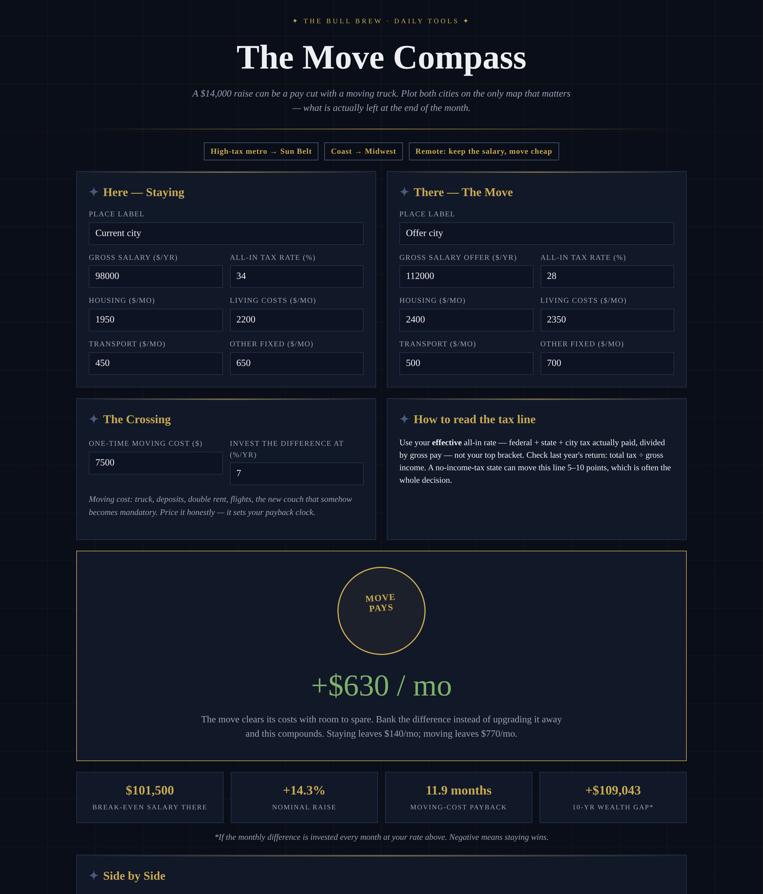

# The Move Compass

**Live:** https://thebullbrew.github.io/move-compass/

A $14,000 raise can be a pay cut with a moving truck. This tool plots staying vs moving on the only map that matters — what is actually left at the end of the month, after each city's real tax bite and real cost of living.

## What it does

- **Side-by-side leftover math** — gross salary taxed at each place's effective all-in rate, minus housing, living, transport and other fixed costs, down to leftover per month and per year.
- **Break-even salary** — solves the exact salary the new city must pay for the move to match staying, so a low offer can be countered in the employer's own arithmetic.
- **Seal verdicts** — MOVE PAYS / PAY CUT IN DISGUISE / STAY PUT / CLOSE CALL, including the trap case where the headline salary rises and the month-end money falls.
- **Moving-cost payback** — months for the monthly gain to retire the truck, deposits and double rent, plus the 10-year wealth gap if the difference is invested monthly.
- **Negotiation table** — leftover and verdict at the offer ±$5k / $10k / $20k, with the break-even line lit.
- **Three presets** (high-tax metro → Sun Belt, coast → Midwest, remote keep-the-salary), cost-anatomy bars for both cities, saveable comparisons (localStorage), copyable summary, works fully offline as a PWA.

## The method behind it

Salary is a headline; leftover is a life. First, taxes are not a footnote — in a cross-state move they can be worth more than the raise itself, so both cities use the effective rate you actually paid (total tax ÷ gross, from last year's return), not a top bracket. Second, housing gets no romance: the cheaper city only wins if you bank the difference instead of upgrading it away. Third, a move has to pay for its own truck — if the monthly gain cannot retire the moving cost inside about two years, you are not relocating, you are donating.

Design: dark old-money variation 17 (Midnight Cartographer) — navy-black with antique-map gold, compass-rose ✦ motifs and fine cartographic hairlines; the data gets the gold.

## How to run

Open `docs/index.html` in any browser, or serve the `docs/` folder with any static host. No build step, no backend, no accounts. Everything runs on your device.

*Estimates only — not financial or tax advice. Built by [The Bull Brew](https://thebullbrew.com) · One useful tool, every day.*
